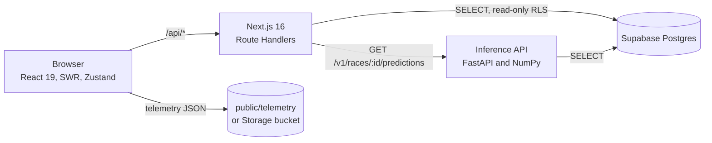

<div align="center">


<br />

**Formula 1 race replay with next-lap time forecasts, and an explanation behind every forecast.**

<br />


[Features](#features) · [Data and model](#data-and-model) · [Architecture](#architecture) · [Getting started](#getting-started) · [API](#api) · [Project structure](#project-structure)

</div>

---

## About

**Next Lap Predictor** replays Formula 1 races from the 2022–2025 seasons while an LSTM model
forecasts each driver's next lap time. When the car crosses the line, the forecast turns into the
real lap time, so you can judge the model lap by lap. The **Why?** card then shows which factors
pushed the forecast up or down.

The project is the visual output of a thesis on predicting F1 lap times with LSTM and GRU networks.
The research notebook and the thesis text live outside this repository, which contains the website,
the model API, and the data scripts.

## Features

| View | What it shows |
| --- | --- |
| **Landing** | Pick a circuit (3D map with real elevation), a season, and a driver, then start the replay |
| **Lap replay** | The forecast for the lap in progress, which turns into the real lap time; track map, live order, colour-coded sectors, tyres, car telemetry, lap log, and a chart of actual against forecast lap times |
| **Head to head** | Two drivers over the same laps: positions on track, lap times, the gap lap by lap, and a side-by-side table |
| **Strategy** | The whole grid's tyre strategy as a Gantt chart, pit stops with the time they cost, and tyre degradation per compound |
| **Race overview** | Classification, qualifying, position and gap per lap, race control, lap time spread, team pace, sector dominance, traffic, and weather |

A few details worth knowing:

- **Why this forecast.** Every forecast is split by feature group (recent pace, traffic, tyres, track,
  race progress, weather, telemetry) using Shapley values of the final model. Values are relative to
  a typical lap of that race. They hint at which information the model used; they do not claim cause
  and effect.
- **No forecast, and why.** A forecast is made only for a clean lap that follows five clean laps on
  the same tyres. Race starts, pit laps, and Safety Car or VSC laps are skipped, and the interface
  says which reason applies.
- **Guided tour.** First-time visitors are walked through every view. The `?` button in the header
  reopens the tour at any time.
- **One tooltip.** Every hover card comes from a single component (`data-tip`) instead of the
  browser's default tooltips.
- **Shareable.** The race, driver, and view are kept in the URL.
- **Honest about training data.** Each forecast carries an `origin` (`in_sample`, `validation`, or
  `out_of_fold`), so a forecast on training data is never presented as evidence of generalisation.

## Data and model

Data lives in the Supabase project `nextlap` (Postgres) and is read-only for the website.

| Item | Count |
| --- | --- |
| Races (2022–2025) | 92, of which 79 are dry and modelled (`predictable`) |
| Circuits | 25 |
| Laps | 101,290 |
| Drivers / teams | 31 / 13 |
| Model runs in `model_runs` | 44 (default: `final:LSTM:E`, id 43) |
| Stored forecasts (`lap_predictions`) | 502,080 |
| Forecast explanations (`prediction_factors`, run 43) | 40,440 |

**Model.** An LSTM that reads a window of the last 5 clean laps and predicts the lap time of the
next lap (t+1) as a change from the window's mean. It uses feature set E: lap and sector times,
speed traps, per-lap telemetry summaries, tyres, weather, traffic, and track evolution. The pipeline,
the parity tests against the notebook, and the deployment are described in
[`inference/README.md`](inference/README.md).

**Results on circuits the model has not seen** (scheme `unseen`: 10 folds, 8,508 test laps; pooled
RMSE computed from the `experiment_results` table):

| Model | RMSE (seconds) |
| --- | --- |
| LSTM, feature set E | 0.3673 |
| GRU, feature set E | 0.3642 |
| Mean-3 (mean of the last 3 laps) | 0.4201 |
| Naive-Last (previous lap) | 0.4335 |

The LSTM lowers RMSE by about 12.6 % against Mean-3. The difference between the LSTM and the GRU is
very small.

> **Note.** Of the 40,440 forecasts of run 43, 31,460 are labelled `in_sample`: they come from races
> the final model was trained on. For claims about generalisation, use the run
> `generalization:unseen:LSTM:E` (id 41, out-of-fold forecasts). The dashboard replays the research
> protocol; it is not a real-time feed.

## Architecture



- **Thin backend.** Route Handlers validate input with `zod`, call a service, and assemble the
  response with pure functions (`assemble`, `summary`) that are unit-tested. Query results are cached
  with `use cache`.
- **Read-only database.** All 11 tables use row-level security with `SELECT` policies only, so the
  publishable key is enough and no service-role key is needed. The `anon` role is limited to
  `statement_timeout = 3s`.
- **Model as a separate service.** When `INFERENCE_API_URL` is set, the website reads the final
  model's forecasts from the model API (10 s timeout, cached for a few hours). If the variable is
  empty, or the API is slow or unreachable, the website falls back to the forecasts stored in
  Supabase without showing an error. The source is reported as `prediction_source`.
- **Car telemetry** comes from one JSON file per driver. Without the files, the car data panel shows
  the averages of the last lap and says so.

## Getting started

Requirements: Node.js 20.9 or later, and a Supabase project that holds the `nextlap` data.

```bash
git clone https://github.com/devilk1d/nextlap.git
cd nextlap
cp .env.example .env.local     # then fill in the variables below
npm install
npm run dev                    # http://localhost:3000
```

| Variable | Required | Purpose |
| --- | --- | --- |
| `SUPABASE_URL` | yes | URL of the Supabase project |
| `SUPABASE_PUBLISHABLE_KEY` | yes | Publishable key (read-only; only read on the server) |
| `INFERENCE_API_URL` | no | URL of the `inference/` service; when empty, stored forecasts are used |
| `NEXT_PUBLIC_TELEMETRY_URL` | no | Public URL of the `telemetry` bucket; when empty, files are read from `public/telemetry` |

The telemetry files (`public/telemetry/`) are not in Git because they are generated from raw data.
Without them, and without `NEXT_PUBLIC_TELEMETRY_URL`, the site still runs and falls back to lap
averages. See [Data scripts](#data-scripts) for how to build them.

Other commands:

```bash
npm test         # Vitest: derived backend logic and the replay engine
npm run lint     # ESLint
npm run build    # production build
```

## Views and URLs

| URL | Shows |
| --- | --- |
| `/` | Landing: choose a circuit, a season, and a driver |
| `/?race=<race_id>` | Lap replay (the default view) |
| `?view=h2h` | Head to head; choose the drivers with `a=<code>&b=<code>` |
| `?view=strat` | Strategy |
| `?view=ov` | Race overview |

Parameters: `race`, `view` (`replay`, `h2h`, `strat`, or `ov`), `drv`, `a`, and `b`.

## API

Responses are JSON with column names exactly as in the database (snake_case). Errors always have the
shape `{ "error": { "code", "message", "details?" } }`, and GET responses are sent with
`Cache-Control: public, max-age=60, s-maxage=3600, stale-while-revalidate=86400`.

| Endpoint | Returns |
| --- | --- |
| `GET /api/races?year=&circuit_key=` | Race and circuit catalogue; `predictable=false` for wet or unmodelled races |
| `GET /api/races/:raceId?model_run_id=` | Replay detail: `race`, `model`, `metrics`, `cars[]` → `laps[]` (lap, telemetry, `prediction`, `dirty_air`), and `prediction_source` |
| `GET /api/races/:raceId/summary` | Factual summary: winner, pole, fastest lap, strategies, SC/VSC/yellow flags, DNFs, lead changes, weather |
| `GET /api/races/:raceId/factors?model_run_id=` | Explanation of each forecast (Shapley value per feature group) |
| `GET /api/circuits` | Circuits |
| `GET /api/models` | Model runs |
| `GET /api/experiments?scheme=&model_type=` | Experiment results per fold |

- An empty `model_run_id` selects the run with `is_default = true`.
- `metrics` compares the stored forecasts with the actual lap times; `rmse_mean3` is the Mean-3
  baseline on the same race.
- The model API (`inference/`) has its own endpoints and interactive documentation at `/docs`.

## Project structure

```
app/                    pages and Route Handlers (api/**)
server/                 backend
  races/ models/ circuits/ reference/   repository → assemble (pure) → service
  inference/            client for the model API, with a database fallback
  db/                   Supabase client, schema types, query helpers
features/               frontend, one folder per feature
  landing/              circuit, season, and driver picker (3D map, three.js)
  dashboard/            shell: header, transport, URL state, race context
  replay/ h2h/ strategy/ overview/      one folder per view
  tour/                 guided tour
  common/               panels shared by several views
components/
  ui/                   Card, Segmented, Dropdown, Table, Tooltip, ...
  charts/               Plot, LineChart, TrackMap, CarMarkers
lib/race/               replay timeline engine, lap flags, events, track geometry and elevation
data/                   outlines of 25 circuits, elevation, pit lanes
inference/              model API (FastAPI) and the final model's weights
scripts/                data and asset builders
supabase/               supporting SQL
```

## Libraries

| Library | Why |
| --- | --- |
| `@supabase/supabase-js` | Database access from the server |
| `zod` | Validation of environment variables and request input |
| `swr` | Fetching and caching race data in the browser |
| `zustand` | The replay clock (about 20 updates per second) without re-rendering the whole dashboard |
| `three` | The 3D circuit map on the landing page |
| `server-only` | Keeps backend modules out of the client bundle |
| `vitest` | Unit tests for pure functions |

Charts are drawn with plain SVG and CSS because the visual style (crosshair, SC/VSC bands, forecast
markers) would need many overrides in a chart library. Fonts (Barlow, Barlow Condensed, Michroma,
and JetBrains Mono) are loaded with `next/font/google`.

## Testing

```bash
npm test                         # 41 tests: timeline, telemetry, race response assembly, forecast parser

cd inference
pip install -r requirements-dev.txt
pytest                           # pipeline parity with the notebook, plus endpoint tests
```

On real data, `inference/scripts/backfill_predictions.py` checks that the RMSE on the validation
races matches the notebook's figure (0.4505 s).

## Data scripts

| Script | Purpose |
| --- | --- |
| `scripts/build_track_geometry.py` | Outlines of 25 circuits from [bacinger/f1-circuits](https://github.com/bacinger/f1-circuits) (MIT) |
| `scripts/build_track_elevation.py` | Real elevation profile per circuit, from the FastF1 cache |
| `scripts/align_track_start.py` | Places each outline's start exactly on the start/finish line |
| `scripts/build_pit_lanes.py` | Pit lane path per circuit |
| `scripts/telemetry/build_telemetry.py`, `upload_telemetry.py` | Turn raw telemetry into one JSON file per driver and upload it to the bucket |
| `scripts/assets/fetch_brand_assets.py` | Download driver photos and team logos |
| `inference/scripts/backfill_predictions.py` | Fill `lap_predictions` for the final run and the baseline |
| `inference/scripts/explain_predictions.py` | Fill `prediction_factors` |

## Deployment

The model API is deployed to Railway (root directory `/inference`, Dockerfile builder, health check
at `/health`); the full steps are in [`inference/README.md`](inference/README.md#deploying-to-railway).
The Next.js website can be deployed as a second service from the same repository with
`SUPABASE_URL` and `SUPABASE_PUBLISHABLE_KEY`.

## Credits and licence

- Race data is public Formula 1 data processed for this research; circuit position and elevation
  traces come from the FastF1 cache.
- Driver photos and team logos belong to Formula 1 and the respective teams and are used for the
  thesis only. This project is not affiliated with Formula 1.
- Circuit outlines: [bacinger/f1-circuits](https://github.com/bacinger/f1-circuits), MIT licence.
- This repository does not yet include a licence file.

<div align="center">

<br />


<sub>Next Lap Predictor · built by <a href="https://github.com/devilk1d">@devilk1d</a></sub>

</div>
