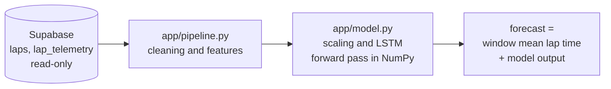

<div align="center">


<br />

**Inference API: next-lap time forecasts from the final LSTM, served with FastAPI and NumPy.**

<br />


[How it works](#how-it-works) · [Model card](#model-card) · [Endpoints](#endpoints) · [Testing](#testing) · [Running locally](#running-locally) · [Configuration](#configuration) · [Deploying to Railway](#deploying-to-railway)

</div>

---

## About

This service serves the final model of the research notebook (v7): an LSTM with feature set E and a
window of 5 laps that forecasts the next lap's time (t+1). It is deployed on its own on Railway; the
Next.js website keeps reading Supabase and, when `INFERENCE_API_URL` is set, asks this service for
the final model's forecasts. The [main README](../README.md) describes the website.

## How it works



| Step | File | What it does |
| --- | --- | --- |
| 1. Read | `app/db.py` | Reads laps and telemetry from Supabase with the read-only publishable key |
| 2. Prepare | `app/pipeline.py` | Cleans the data and builds features; a copy of the notebook's steps (sections 3.2, 4, 6, and 7) |
| 3. Predict | `app/model.py` | Normalises each window, applies the MinMax scaler, and runs the LSTM forward pass in NumPy |
| 4. Serve | `app/main.py`, `app/service.py` | Exposes the forecasts and their metrics over HTTP |

The model runs on NumPy, not TensorFlow. The weights of `model_final.keras` are exported to
`model/weights.npz` and the scaler to `model/scaler.json`. This keeps the image small (about 250 MB
instead of about 2 GB with TensorFlow) and the memory use low (about 150 MB). The difference from
Keras is below 0.000001 seconds.

## Model card

| | |
| --- | --- |
| Architecture | LSTM (64 units) → dropout (0.2, training only) → dense (32, ReLU) → dense (1) |
| Window | 5 clean consecutive laps of one stint |
| Features | 55 per lap (feature set E, "+Track evolution"); dynamic features are taken relative to the window mean, then MinMax-scaled and clipped to [0, 1] |
| Target | `LapTime(t+1) − mean(LapTime over the window)`; forecast = window mean + model output |
| Training | Learning rate about 0.0022, batch size 256 |
| Training data | Roughly the first 80 % of races in the calendar |

The full list of features and hyperparameters is returned by `GET /v1/model`.

> **Note.** Forecasts for races labelled `in_sample` come from laps the final model was trained on.
> For claims about generalisation use the run `generalization:unseen:LSTM:E` (out-of-fold forecasts).
> Data cleaning also uses statistics of one whole race (the race median and the centred stint trend), exactly as in the notebook, so this
> service replays the research protocol; it is not a real-time feed.

## Endpoints

| Endpoint | Returns |
| --- | --- |
| `GET /health` | Status and model type (used by the Railway health check) |
| `GET /v1/model` | Model card: features, hyperparameters, and the validation races |
| `GET /v1/races` | Races with their `origin` (`in_sample` or `validation`) for the final model |
| `GET /v1/races/{race_id}/predictions?driver=VER&include_open=false` | Forecasts for every forecastable lap, plus metrics (RMSE, MAE, MAPE, Mean-3) |
| `GET /v1/races/{race_id}/drivers/{code}/laps/{lap}` | The forecast for one lap, from the 5 clean laps before it |
| `POST /v1/predict` | Forecasts from raw feature windows: `{ "windows": [[[55 values] × 5], ...] }`, up to 5,000 windows |
| `GET /docs` | Interactive documentation (Swagger UI) |

- `include_open=true` also forecasts the lap that follows the last clean window of each stint
  segment, for example an in-lap. These laps have no counterpart in the notebook, so they are left out
  of the metrics.
- A race that does not exist returns `404`. A race outside the model's scope (wet or unmodelled)
  returns `422` with the reason.
- Origins are allowed by `ALLOWED_ORIGINS`; only `GET` and `POST` are enabled for CORS.

## Testing

| Test | What it checks |
| --- | --- |
| `test_parity.py` | The API pipeline against a verbatim copy of the notebook code (`tests/notebook_reference.py`) on synthetic races with pit stops, Safety Cars, yellow flags, deleted laps, broken telemetry, rain, and wet-tyre races. Window inputs, targets, and forecasts must be identical, for all races at once and per race. |
| `test_parity.py::test_numpy_forward_matches_keras` | The NumPy forward pass against Keras. It runs when TensorFlow is installed and `experiment_results_v7/` exists at the repository root. |
| `test_api.py` | Every endpoint, with a mocked database. |

A check on real data is done by `scripts/backfill_predictions.py`: the RMSE on the validation races
(all drivers) must equal the notebook's "RMSE without permutation" in section 14.3, which is
**0.4505 s**.

```bash
pip install -r requirements-dev.txt
pytest
```

## Running locally

Python 3.12 is used in the Docker image and is the version to match.

**Windows (PowerShell)**

```powershell
cd inference
python -m venv .venv
.venv\Scripts\Activate.ps1
pip install -r requirements-dev.txt
Copy-Item .env.example .env        # then set SUPABASE_URL and SUPABASE_PUBLISHABLE_KEY in .env
uvicorn app.main:app --reload      # http://localhost:8000/docs
pytest
```

**macOS and Linux** use the same steps with `source .venv/bin/activate` and `cp .env.example .env`.

The `.env` file is read automatically by `app/db.py`, so you do not need to set variables in the
shell. Variables that already exist in the environment take priority, which is what happens on
Railway.

If the model is retrained, export it again and commit the `model/` folder:

```bash
python scripts/export_model.py ../experiment_results_v7
```

## Configuration

| Variable | Required | Purpose |
| --- | --- | --- |
| `SUPABASE_URL` | yes | URL of the Supabase project (the same one as the website) |
| `SUPABASE_PUBLISHABLE_KEY` | yes | Publishable key; read-only |
| `ALLOWED_ORIGINS` | no | Comma-separated origins that may call the API from a browser; defaults to `*` |
| `SUPABASE_SECRET_KEY` | scripts only | Only for `--write` in the scripts below; set it on your own machine, never on Railway |
| `PORT` | set by Railway | Port to listen on; the local default is `8000` |
| `WEB_CONCURRENCY` | no | Number of Uvicorn workers; defaults to `1` |

## Deploying to Railway

1. In Railway, choose **New Project → Deploy from GitHub repo** and select `devilk1d/nextlap`.
2. Open the service and set **Settings → Source → Root Directory** to `/inference`.
   Railway reads `inference/railway.json` (Dockerfile builder, health check at `/health`).
3. Add these **Variables**:
   - `SUPABASE_URL`: the URL of the `nextlap` project
   - `SUPABASE_PUBLISHABLE_KEY`: the publishable key (read-only, the same as the website)
   - `ALLOWED_ORIGINS`: the website's domain, for example `https://nextlap.up.railway.app` (`*` is allowed)
4. Under **Settings → Networking**, choose **Generate Domain**, then check
   `https://<domain>/health` and `/docs`.

Do not set `SUPABASE_SECRET_KEY` on Railway; it is only for back-filling from your own machine.

### The website on Railway (optional, same project)

Add a second service from the same repository with the Root Directory left empty (`/`). Railway
detects Next.js on its own (`npm run build`, `npm start`; `next start` uses the `PORT` variable). Set
`SUPABASE_URL` and `SUPABASE_PUBLISHABLE_KEY`, add `INFERENCE_API_URL` pointing at this service if you
want live forecasts, and generate a domain.

## Storing the final model's forecasts in Supabase

The runs `final:LSTM:E` (id 43) and the comparison `final:Mean-3` (id 44) exist in `model_runs`. This
script fills in the forecasts of both. Mean-3 uses the same `origin` label as the LSTM, because the
website compares the two per origin:

```bash
cd inference
python -m scripts.backfill_predictions            # computes and prints RMSE per race and per origin
# set SUPABASE_SECRET_KEY in .env (on your own machine only), then:
python -m scripts.backfill_predictions --write
```

The forecasts are then available through `GET /api/races/:raceId?model_run_id=43` on the website.
The dashboard uses the run with `is_default = true`, which is run 43.

### Explaining the forecasts

`scripts.explain_predictions` splits every forecast of the run into the contribution of seven feature
groups (pace, progress, telemetry, tyres, weather, traffic, and track) with exact Shapley values.
Seven groups need 2⁷ = 128 forward passes per window, and nothing is retrained. The result goes to
the `prediction_factors` table (defined in `scripts/prediction_factors.sql`) and drives the Why? card
on the website:

```bash
python -m scripts.explain_predictions             # dry run: computes, checks, saves factors_final.csv
python -m scripts.explain_predictions --write     # writes to prediction_factors (needs SUPABASE_SECRET_KEY)
```

The script writes to the run named `final:LSTM:E`, so `is_default` must stay on run 43. If you move
it, run the script again for the new run.

> **Note.** 31,460 of the 40,440 forecasts of run 43 are labelled `in_sample` (training data). For
> claims about generalisation use run 41 (out-of-fold). The website caches query results (`use
> cache`, a few hours), so a change of `is_default` is only visible after the server is restarted or
> redeployed.

<div align="center">

<br />


<sub>Next Lap Predictor · inference API · built by <a href="https://github.com/devilk1d">@devilk1d</a></sub>

</div>
